<div align="center">

<picture>
  <source media="(prefers-color-scheme: dark)" srcset=".github/assets/banner-dark.svg">
  
</picture>

**Laravel Echo for PAM Native: Pusher and Reverb channels, owned by the platform.**<br>
Public, private and presence channels with native reconnects, heartbeats and batched delivery to PHP.

[](https://packagist.org/packages/pushinbr/pam-native-realtime)
[](https://github.com/push-in/pam-native-realtime/releases/latest)

[](https://github.com/push-in/pam-native-realtime/actions/workflows/ci.yml)
[](LICENSE)

[Install](#install) · [Quick example](#quick-example) · [Platforms](#platform-support) · [Permissions](#requirements) · [Docs](#docs) · [Issues](https://github.com/push-in/pam-native-realtime/issues)

</div>

<a id="install"></a>
## <picture></picture> Install

Inside a PAM Native project, add only this capability:

```sh
pam composer require pushinbr/pam-native-realtime
pam doctor --fix
```

New to PAM? Create a project with `pam init my-app --template native` (see the [PAM Native overview](https://push-in.github.io/pam-docs/native/overview/)), then come back here. Composer owns the manifest and the lockfile; `pam composer` runs it on PAM's verified PHP runtime.

<a id="quick-example"></a>
## <picture></picture> Quick example

```php
<?php

declare(strict_types=1);

use Pam\Native\Realtime\PresenceMember;
use Pam\Native\Realtime\Realtime;
use Pam\Native\Realtime\RealtimeMessage;
use Pam\Native\Realtime\RealtimeStatus;
use Pam\Native\Realtime\Secret;

// Once, after sign-in (Laravel Reverb / Pusher Channels / Soketi).
Realtime::pusher('wss://ws.example.com', key: 'app-key')            // or Realtime::reverb('ws.example.com', 'app-key')
    ->auth('https://api.example.com/broadcasting/auth', Secret::value($token))
    ->header('Origin', 'https://example.com')
    ->onConnected(fn (RealtimeStatus $s) => $this->catchUp())        // first connect and every reconnect
    ->connect();

// Echo style channels, from any screen.
Realtime::channel('private-chat.42')                                 // or Realtime::private('chat.42')
    ->listen('message.sent', fn (RealtimeMessage $m) => $this->append($m->json()))
    ->listenForWhisper('typing', fn (RealtimeMessage $m) => $this->typing($m->userId));

Realtime::join('chat-typing.42')                                     // presence-chat-typing.42
    ->here(fn (array $members) => $this->online = count($members))
    ->joining(function (PresenceMember $m): void { /* ... */ })
    ->leaving(function (PresenceMember $m): void { /* ... */ })
    ->whisper('typing', ['typing' => true]);                         // sent as client-typing

Realtime::leave('chat.42');                                          // leaves chat.42, private-… and presence-…
Realtime::token($refreshed);                                         // new bearer; 401/403 channels retry at once
$headers['X-Socket-ID'] = Realtime::socketId() ?? '';                // Laravel toOthers()
```

The socket, the Pusher protocol, channel auth, heartbeats, reconnects and re-subscription run natively; PHP receives coalesced batches (one render per burst, no polling, no PHP timer). A runnable presence chat room is in [`example/`](example). Full details: [API reference](docs/api-reference.md) · [Batching and connection lifecycle](docs/connection-lifecycle.md) · [A real example: Zé Chat](docs/ze-chat-example.md).

<a id="platform-support"></a>
## <picture></picture> Platform support

| Platform | Support | Notes |
| --- | --- | --- |
| Android | API 26+ | OkHttp 5.3.0 |
| iOS | 15.0+ | `URLSessionWebSocketTask`, `NWPathMonitor`; not validated on a device yet (see `ios/Tests/PusherTests.swift`) |
| PAM Native | 1.0.35 to < 2.0.0 | From `pam-native.plugin.json`; PHP 8.5+ |

<a id="requirements"></a>
## <picture></picture> Permissions and requirements

| Platform | Declared by the plugin |
| --- | --- |
| Android | `android.permission.INTERNET`, `android.permission.ACCESS_NETWORK_STATE` (network-change recovery). No runtime permission. |
| iOS | Framework `Network` (`NWPathMonitor`); no Info.plist keys. |

The package is a PAM Native plugin (module `realtime`); nothing is added to `pam-native.json`. The socket does not run while iOS suspends the app; once the app runs again the liveness checks reconnect and re-subscribe (call `Realtime::reconnect()` on `AppState::Active` to skip a pending backoff). End-to-end encrypted channels (`private-encrypted-*`) are rejected.

<a id="what-you-can-build"></a>
## <picture></picture> What you can build

- Chat, presence and collaborative state
- Live dashboards and operations consoles
- Realtime alerts and server-driven updates

| | |
| --- | --- |
| **Native path** | OkHttp WebSocket · URLSessionWebSocketTask |
| **Application model** | Composer package + generated native integration |
| **Design rule** | Independent module; no feed, vertical or application template bundled |

<a id="compatibility"></a>
## <picture></picture> Compatibility

| `pushinbr/pam-native-realtime` | `pushinbr/pam-native` | Android | iOS |
| --- | --- | --- | --- |
| 0.4.x | `>=1.0.35 <2.0.0` (tested with 1.14.x) | API 26+ | 15+ (Pusher client) |
| 0.3.x | `>=1.0.35 <2.0.0` | API 26+ | Raw socket only |

<a id="testing"></a>
## <picture></picture> Testing

```bash
pam tests/run.php                                                    # PHP contracts (fake native transport)
cd android && ANDROID_SERIAL=emulator-5558 \
  ../../../pam-native/android/gradlew -p . connectedDebugAndroidTest   # Pusher protocol suite against MockWebServer
```

<a id="production-rules"></a>
## <picture></picture> Production rules

- Accept only authenticated `wss://` endpoints and an `https://` auth endpoint.
- Refresh credentials with `Realtime::token()` instead of reconnecting.
- Resynchronize from your API in `onConnected` (reconnects) and `onDropped`.
- Run `pam doctor`, `pam test` and a signed release build on every supported platform.

Security vulnerabilities should be reported through the repository security policy or GitHub private vulnerability reporting, not a public issue.

<a id="docs"></a>
## <picture></picture> Docs

- [PAM Native overview](https://push-in.github.io/pam-docs/native/overview/)
- [Plugin and native capability model](https://push-in.github.io/pam-docs/native/plugins/)
- [PAM introduction](https://push-in.github.io/pam-docs/introduction/)
- [Changelog](CHANGELOG.md)
- [Report an issue](https://github.com/push-in/pam-native-realtime/issues)
- [API reference](docs/api-reference.md)
- [Batching and connection lifecycle](docs/connection-lifecycle.md)
- [A real example: Zé Chat](docs/ze-chat-example.md)
- [Runnable example app](example/README.md)

<a id="pam-ecosystem"></a>
## <picture></picture> Part of the PAM ecosystem

<p align="center"><picture>
  <source media="(prefers-color-scheme: dark)" srcset=".github/assets/pam-wordmark-dark.svg">
  
</picture></p>

PAM runs PHP natively on servers, desktops and phones. This repository is one piece of it.

| [**PAM**](https://github.com/push-in/pam) | [**PAM Desktop**](https://github.com/push-in/pam-desktop) | [**PAM Native**](https://github.com/push-in/pam-native) | [**Ecosystem**](https://github.com/push-in/pam#ecosystem) |
| --- | --- | --- | --- |
| the runtime and CLI | native desktop apps in PHP | native Android and iOS apps in PHP | every official package and plugin |

<sub>Docs: [push-in.github.io/pam-docs](https://push-in.github.io/pam-docs/introduction/) · [Issues](https://github.com/push-in/pam-native-realtime/issues)</sub>

<p align="center"><sub><a href="LICENSE">Apache License 2.0</a> · Made in Brazil by Pushin</sub></p>
